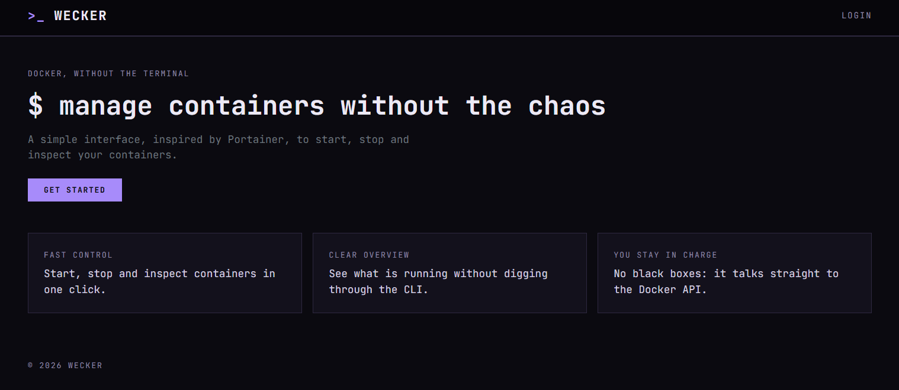
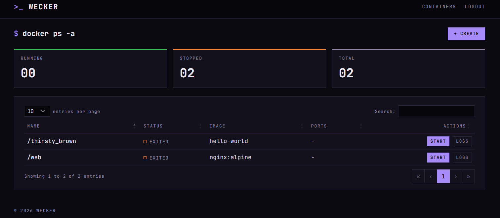

# Wecker
**A simple and powerful interface inspired by Portainer to control your containers visually.**




Note: Requires Docker Desktop on Windows/macOS.

# Setup Env
1. Install docker.
    1. On windows you need to activate WSL2 and enable "Expose daemon on tcp://localhost:2375 without TLS" option.
2. Install [just](https://just.systems) (e.g. `sudo apt install just`, `brew install just` or `winget install Casey.Just`).
3. Run `just install`: it creates the `.env` files, builds and starts the containers, installs the Composer dependencies, runs the database migrations and asks for the admin's name, email and password.
4. Open http://localhost.

# Common commands
Run `just` to list every command. The most used:

```bash
just up | stop | status | logs   # containers
just migrate                     # apply pending database migrations
just admin-create                # create another admin
just test | stan | cs            # tests, static analysis, code style
```

# How it works
Architecture notes for developers (in Portuguese) live in `.claude/arch-explain/`. Start with `request-flow.md`.

# Pending to Fix
- Implement tests.
- Implement BlockUI.

# Future Implements
- Health Status.
- Docker installation info.
- Web console to manage containers.
- Log Operations (Start, Stop, Log).
- Create containers.
- Real time docker logs.
- Improve UI and UX.
